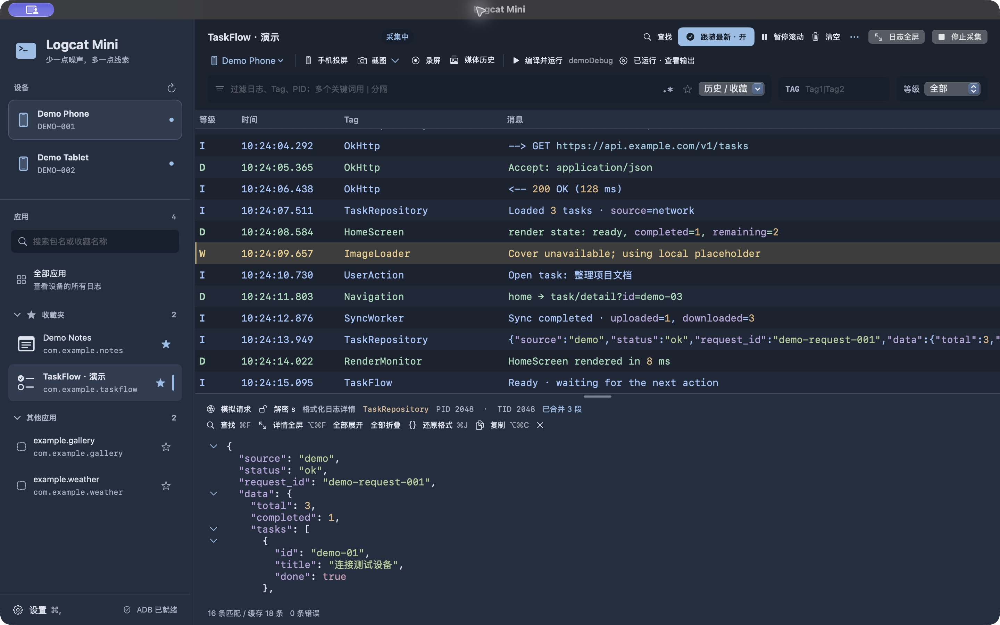
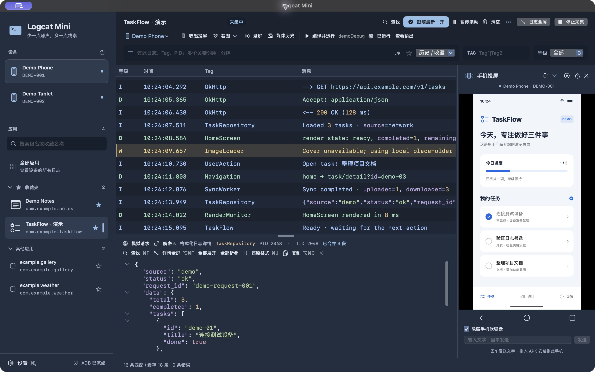
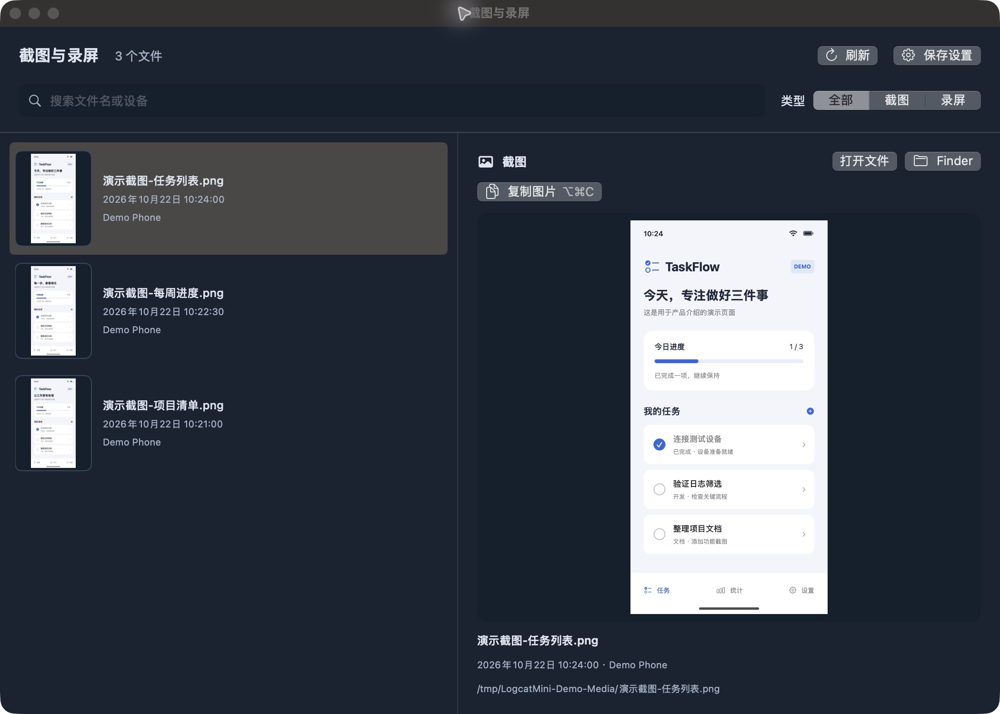
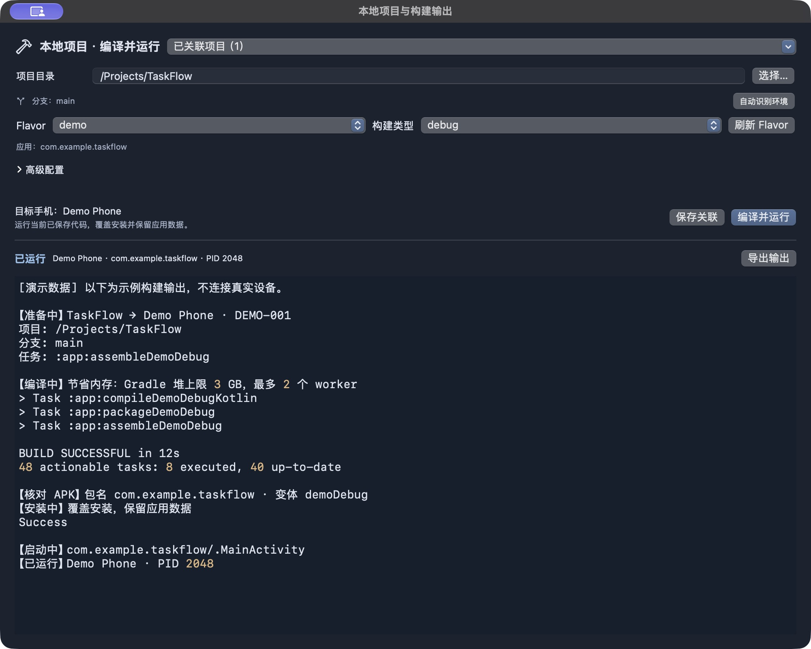

# Logcat Mini

**少一点噪声，多一点线索。**

Logcat Mini 是一款轻量的 Android 日志与设备调试工具，把查日志、操作手机、截图录屏和运行本地项目放在一起。连接已授权的 Android 设备，选中应用，就可以开始排查问题。

A lightweight Android log viewer and device toolbox, with a native macOS app and a Windows preview.

[](https://github.com/Fiveyearsago/LogcatMini/actions/workflows/macos.yml)
[](LICENSE)

原生 macOS 客户端使用 SwiftUI + AppKit；另有 Avalonia + .NET 实现的 Windows 预览版。**下面的功能介绍与截图以 Mac 版为准**，Windows 的支持范围见 [windows/README.md](windows/README.md)。

[功能介绍](#功能介绍) · [从源码运行](#mac-从源码运行) · [开始使用](#开始使用) · [数据与网络](#数据与网络) · [参与贡献](CONTRIBUTING.md)

> 以下截图使用实际 Mac 界面；设备、应用、日志、手机演示画面和构建输出均为合成数据，不包含真实用户数据。点击图片可查看原图。

## 功能介绍

### 1. 快速找到需要的日志

在侧栏切换设备和应用，把常用 App 加入收藏。关键词、Tag 和日志等级集中在同一条筛选栏，尽量把空间留给日志本身。

- **缩小范围**：支持按应用 / UID 采集，关键词、Tag、最低等级与正则过滤；多关键词可用 `|` 分隔，常用筛选可收藏。
- **读清上下文**：查找并跳转匹配项，暂停滚动仔细查看，再一键跟随最新。暂停滚动期间仍继续采集日志。
- **展开细节**：点击一条日志查看完整内容；JSON 与键值内容支持格式化，JSON 节点可折叠。日志列表和详情都可单独全屏。
- **处理长日志**：识别支持格式的连续分段日志并合并，支持在设置中添加合并规则；复制或导出时保留合并后的内容。任意格式的分段并不保证都能自动识别。



### 2. 边操作手机，边观察日志

手机画面直接放在日志右侧。重现问题时，在同一个窗口点击 App、切换页面，同时观察对应的日志变化。

- 鼠标点击、拖动、滚轮滑动，配合返回、主屏幕和最近任务按钮。
- 在电脑输入框输入文字，按回车或点击发送传到手机；可选择隐藏手机软键盘，具体支持取决于设备和输入法。
- 将 APK 拖到手机画面上，直接安装到当前投屏设备。
- 投屏区域可调整宽度，也可以收起，继续查看日志。



### 3. 截图、录屏与可视化历史

遇到问题时直接截图或录屏，再从媒体历史中通过缩略图找到对应画面，减少反复打开文件确认的步骤。

- **截图**：保存图片并自动复制到剪贴板，也支持仅复制，方便粘贴到问题说明中。
- **录屏**：开始 / 停止录制，保存为视频；当前最长 3 分钟，不录制声音。
- **历史预览**：截图和录屏都有缩略图；选择后可查看大图或播放视频，支持按文件名、设备和类型筛选。
- **文件管理**：自选本机保存目录，支持复制图片、打开文件、在 Finder 中定位。



### 4. 从本地源码编译、安装并启动

给 App 关联本地 Android 项目，选择 Flavor 和构建类型，即可在 Logcat Mini 中运行当前已保存的代码，无需打开 Android Studio。

- 自动识别项目环境与可用变体；多 Flavor 项目可在下拉菜单中选择。
- 显示当前 Git 分支，方便确认源码来源；分支切换仍由你常用的 Git 工具完成。
- 一次执行编译、核对 APK、覆盖安装和启动，构建输出可查看、取消或导出。
- 支持手动配置模块、变体、JDK 和 Android SDK；节省内存模式将 Gradle 堆上限设为 3 GB、最多使用 2 个 worker，并在构建结束后退出本次 Gradle 进程。该数值不是所有构建进程的总内存上限。

需要项目自带 Gradle Wrapper，并配置兼容的 JDK、Android SDK。当前安装流程面向单个通用 APK；Release 需在项目中配置签名。覆盖安装保留应用数据，不自动卸载应用。



### 5. 请求调试与可选的 s 串处理

从日志导入请求，编辑 URL、请求头和 Body 后发送，并查看响应、保存请求记录。适合把一次请求单独拿出来检查。

包含 `s` 的片段日志也可以进入解密工具，不要求日志必须是一条完整网络请求。解密服务地址和 RSA 密钥由使用者自行配置；开源版不附带业务服务或密钥，也不保证支持任意应用的加密格式。协议范围见 [s 串扩展说明](docs/s-packet.md)。

界面还提供多种主题、字号调整和日志列设置，可以按屏幕大小和阅读习惯调整。

## Mac 0.17.2 更新

- 手机息屏后，点击投屏画面或黑边即可唤醒；不会自动解除密码锁，已亮屏时仍可正常操作。
- 手机复制的文字会同步到 Mac；投屏中按 `⌘C` 获取手机所选文字，`⌘V` 将 Mac 剪贴板文字发送到手机。
- 投屏顶部可查看设备信息，并按需安装设备信息助手读取 GAID。成功结果按设备缓存在本机；重开面板不会自动读取，刷新失败保留旧值。广告 ID 设置入口仅打开手机系统设置，由使用者确认操作。
- “关于”显示版本号、构建号及精确到秒的发布时间，不附加时区文字；时间在构建时固定，安装或重启不会改变。
- 增加猫咪互动、值班日记和纸箱彩蛋。

设备信息助手没有联网权限，不在后台采集或保存 ID；只通过已授权 ADB 返回读取结果。Android ID 是当前用户的 ADB Shell 值，不代表其他应用的 SSAID。助手源码及构建方式见 [设备信息助手](android-helper/device-info/README.md)。

当前为 `feature/mac-automation` 实验分支，包含 Mac 主线全部功能。主窗口顶部可切换“日志 / 自动测试”：支持完整 APK 安装、固定用例执行、控件定位、日志断言、失败截图、历史复测与 Markdown 报告导出。新增 `belowText` 关系定位、动态页面控件树回退及新版 aapt2 元数据解析。

构建、组件配置、离线演示及限制见 [自动测试使用说明](docs/automation-testing-mac-preview.md)。测试使用本机 ADB / Maestro，不接入 AI；日志和截图留在本机，分享报告前需自行检查其中的业务信息。

## Mac 从源码运行

运行环境为 macOS 13+；构建需要带 macOS SDK 的 Xcode、Swift 5.9+，以及首次下载录屏组件时的网络连接。ADB 请从 [Google Platform-Tools](https://developer.android.com/tools/releases/platform-tools) 获取，或使用已有 Android SDK。

```sh
git clone https://github.com/Fiveyearsago/LogcatMini.git
cd LogcatMini
bash scripts/prepare-recording-runtime.sh
swift test
bash scripts/build-app.sh
open 'dist/Logcat Mini.app'
```

`prepare-recording-runtime.sh` 下载指定版本的官方 scrcpy，校验 SHA-256，并准备投屏 / 录屏组件。第三方运行时二进制不提交到此仓库。仓库附带自有 Android 元数据和设备信息辅助程序，源码位于 `android-helper/`。元数据程序可使用 Android SDK 35、build-tools 35.0.0 和 JDK 17 运行 `bash scripts/build-android-helper.sh` 重建；设备信息助手构建方式见其 README。

安装到当前用户的应用目录：`bash scripts/build-app.sh --install`。
生成 Apple Silicon / Intel 通用 ZIP：`bash scripts/package-share.sh`。
本地构建使用 ad-hoc 签名，不包含 Developer ID 签名或 Apple 公证。Intel 架构可编译，但尚无 Intel Mac 实机验收。

## 开始使用

1. 手机开启 USB 调试，连接 Mac，并在手机上授权这台电脑。
2. 启动应用；如未发现 ADB，在设置中选择 `adb` 文件。
3. 在侧栏选择设备和应用，实时查看日志。点击手机投屏可边操作边查看。
4. 使用筛选栏的关键词、Tag 和等级缩小范围。多关键词以 `|` 分隔；正则开关开启后按完整表达式匹配。
5. 退出前导出需要保留的日志。截图和录屏首次使用时选择本机保存目录。

常用快捷键：`⌘F` 查找，`⌘L` 切换跟随（暂停时恢复），`⌘P` 暂停 / 恢复滚动，`⌘K` 清空视图，`⌘⇧F` 日志全屏，`⌘⇧S` 导出，`⌥⌘S` 保存截图并复制，`⇧⌘C` 仅复制截图。

## 数据与网络

日志保存在本机内存中；偏好、收藏、设备 GAID 缓存及请求 / 媒体历史保存在使用者的本机目录。没有账号系统、日志上传后台或遥测。ADB 操作仅针对你已授权的设备。

请求重放会把你编辑的请求发送到指定 URL。远程解密默认没有服务地址，只有在填写地址并点击“服务解密”时才发送所选 s。公钥 / 私钥需自行导入，只在本次运行中使用，不附带业务密钥。s 编解码仅支持文档描述的特定封装，不保证适用于任意应用，见 [s 串扩展说明](docs/s-packet.md)。

不要将真实日志、请求凭证、设备标识或密钥提交到仓库或公开 Issue。详情见 [SECURITY.md](SECURITY.md)。

## 项目结构

| 目录 | 内容 |
| --- | --- |
| `Sources/LogcatMini` | 原生 Mac 客户端 |
| `Sources/LogcatCore` | 日志解析、合并、过滤、格式化和请求处理 |
| `Tests` | 自动测试与合成日志样本 |
| `android-helper` | 应用名称 / 图标辅助程序源码 |
| `windows` | Windows 预览版与检查程序 |
| `scripts` | 构建、组件准备和打包入口 |

## 贡献与许可

欢迎提交可复现的问题和小范围 Pull Request。开发与验证约定见 [CONTRIBUTING.md](CONTRIBUTING.md)。

项目原创代码使用 [MIT License](LICENSE)。第三方代码、组件和许可证不因本项目许可而改变，见 [THIRD_PARTY_NOTICES.md](THIRD_PARTY_NOTICES.md)。
